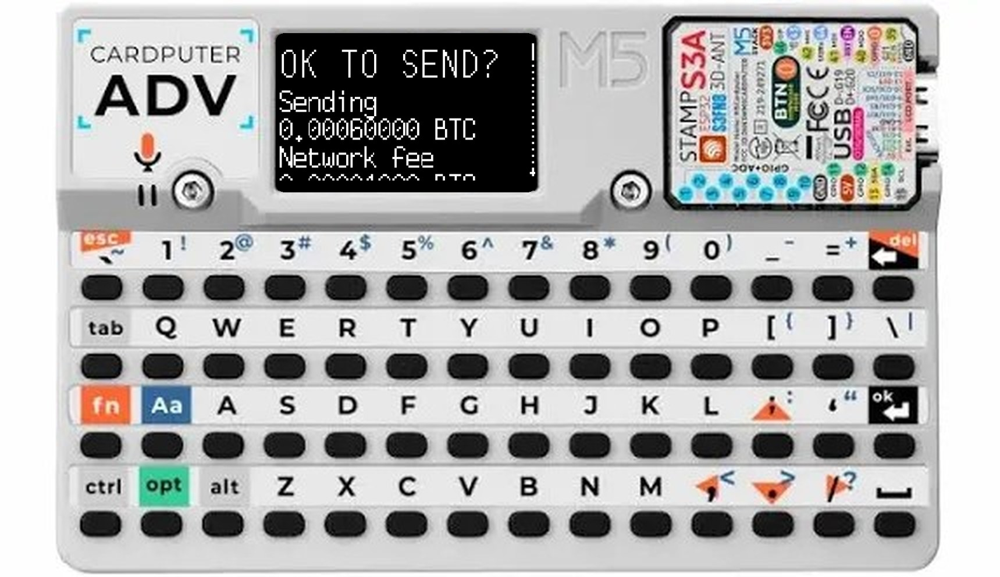
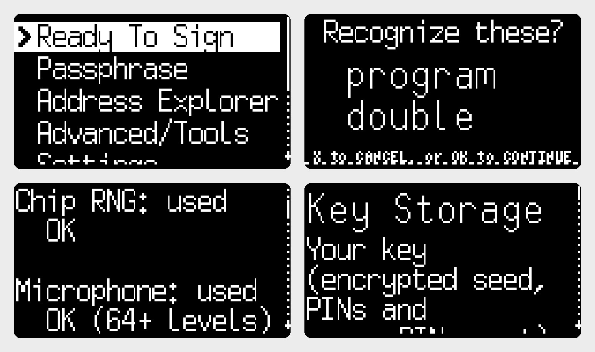
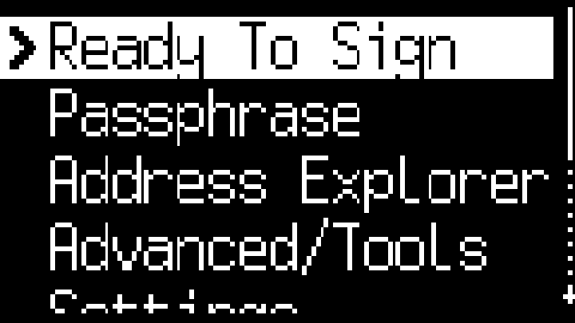
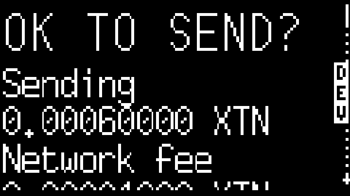

# LukewarmCard ADV

**A poor man's port of COLDCARD firmware to the M5Stack Cardputer ADV.**

LukewarmCard ADV runs Coinkite's open-source
[COLDCARD firmware](https://github.com/Coldcard/firmware), essentially
unmodified, on a ~$30 M5Stack Cardputer ADV (ESP32-S3, 240x135 screen,
56-key keyboard, microSD). It's not as cold as the real thing: hence the name.

This is the **Keypad edition**: it runs the COLDCARD **Mk4/Mk5** firmware
(5.6.3), with the Cardputer's keys standing in for the Mk5's number pad.

> **Unofficial.** LukewarmCard is an independent hobby project. It is **not
> affiliated with, endorsed by, or supported by Coinkite Inc.** COLDCARD is a
> trademark of Coinkite; the name is used here only to say which firmware
> this runs. Don't contact Coinkite for help with it.

> **Security: read this first.** A real COLDCARD keeps its secrets in two
> secure-element chips built to resist physical attack. The Cardputer has
> none. Your encrypted seed (in internal flash or on the SD card, your choice)
> is protected only by your PIN, and anyone who copies it can try PINs on a
> computer without limit. Nothing stops someone installing modified firmware
> on your device. **Use a strong BIP-39 passphrase, keep amounts small, and
> treat this as a learning and tinkering device**, not a vault. Details in
> "Security" below.





*Main menu, the anti-phishing words shown while entering your PIN, Entropy
Sources (microphone and gyro noise mixed into new seeds), and Key Storage
(keep your encrypted key on the SD card or in internal flash). Screens from
the desktop test build; the transaction above is on testnet.*

### Install

Download from **Releases**: `lukewarmcard-adv-keypad-<version>-launcher.bin`
(install with M5Launcher) or `...-full-flash.bin` (write at 0x0 with esptool
/ a web flasher). Check it against `SHA256SUMS.txt`.

| COLDCARD key | Cardputer |
|---|---|
| 0-9 | `0`-`9` |
| OK | `Enter` |
| X | `esc` (`` ` ``) or `del` (Bksp) |
| up, down, left, right (5, 8, 7, 9) | `;` `.` `,` `/` (with or without `Fn`) |

### Good to know

- **It identifies itself to computers with Coinkite's USB IDs**
  (VID d13e / PID cc10) so Sparrow, Electrum, HWI etc. treat it as a COLDCARD
  and use its protocol. The USB name strings say "LukewarmCard".
- **Firmware updates from Coinkite (.dfu files) don't install on it.** Build
  new images from a new COLDCARD release with one command:
  [BUILDING.md](BUILDING.md).
- **Licence:** COLDCARD is MIT + "Commons Clause": free to use, change and
  share, **not to sell**. LukewarmCard is released on the same terms. Never
  charge for it, for support, or for devices with it installed. See
  [NOTICE.md](NOTICE.md) for every component and licence.
- In the build scripts and source the Keypad edition is called `mk4`, after
  the COLDCARD code path it runs (the Mk4 and Mk5 share one firmware line).

COLDCARD's wallet logic (about 42,000 lines of MicroPython: PSBT signing,
trick PINs, BIP-85, Seed XOR, multisig, secure notes, paper wallets, Codex32,
spending policy, and more) runs **unmodified** apart from a handful of
small, exact-match patches. Everything Cardputer-specific is in `hal/`.

## Status

| | |
|---|---|
| Real hardware (M5Launcher image) | Boots; creates seed and wallet; Sparrow finds it over USB and **signs and sends transactions**; paper wallets and backups saved to SD:/MK5; backup / reinstall / restore; logout; self-test (LED, mic, gyro, SD); entropy sources (mic, gyro) in use. Key stored on the SD card. Passphrase entry. **Virtual Disk**: shows up on the computer as a USB drive. Memory measured: lowest 69 KB free after signing. |
| Desktop test build | Full firmware runs headless on Linux with the same code and C modules |
| Verified on desktop | Terms → set PIN → import seed (Mk4 letter menus) → **sign PSBT from microSD**, signature checked independently with `embit` |
| Verified on desktop | Trick PINs: BIP-85 duress PIN opens the correct wallet (fingerprint F00F1FC0 matches embit's BIP-85 index 2001); brick options can be shown or hidden |
| Verified on desktop | Emulated secure element: 29 unit tests (persistence, encryption at rest, tamper detection, brick/wipe/Last Chance paths leave a usable blank device) |

## Security: what you do and don't get

- **No secure element.** COLDCARD's two secure chips are emulated in software
  (`hal/common/secel_soft.py`). The seed is encrypted at rest under a key
  derived from your PIN (PBKDF2-SHA512) and a random master key. But anyone
  holding the device can copy the flash and **brute-force the PIN offline**.
  An 8-digit PIN won't survive a GPU for long.
  **Use a BIP-39 passphrase** (never stored on the device) for real protection.
- **No radios.** WiFi and Bluetooth are compiled out of the firmware.
- **True randomness, from three sources.** COLDCARD makes a seed from
  `sha256d(MCU random + SE1 random + SE2 random)`. Here the MCU part is the
  ESP32's hardware RNG (only truly random while its ADC noise source is on:
  the firmware turns it on at boot and the crypto library refuses to produce
  random bytes if it is ever off). The SE1 and SE2 parts are the chip RNG
  again **mixed with microphone noise** (SE1) and **motion-sensor noise**
  (SE2), each through SHA-256. A sensor that is missing or fails its health
  check is left out and the chip RNG is used alone; a seed is never blocked
  by a sensor, and never made without the chip RNG. Check them under
  **Advanced/Tools > Entropy Sources**. See "Randomness" below.
- **No eFuses burned, ever.** The Cardputer can always be reflashed:
  power switch off, hold **G0**, plug in USB, run esptool.
- **USB console locked** in release builds (Ctrl-C can't drop to a Python prompt).
- Trick-PIN slots are stored encrypted under their own PIN. "N wrong PINs"
  policies are stored in the clear, since there's no PIN to encrypt them with.

## Mk4/Mk5 firmware on the Cardputer

The firmware Coinkite ships for the Mk4 and Mk5 (they share one firmware
line). COLDCARD's own Mk4 modules run unmodified: `display.py` (OLED screen
code), `ux_mk4.py`, `menu.py` with the 5/8 navigation, the Mk4 PIN and
seed-word entry. The module set is exactly Coinkite's Mk4/Mk5 set. One extra
one-line patch stops `display.py` opening the STM32's SPI bus.

What's Cardputer-specific (in `hal/mk4/`):

- `ssd1306.py`: stands in for the OLED driver. COLDCARD draws into the same
  128x64 1-bit buffer as on a real OLED; `show()` sends it to the LCD, scaled in
  C (`lcd.send_mono`). `features.MK4_SCREEN = 'fit'` (240x128) or `'actual'` (1:1).
- `mempad.py`: stands in for the membrane keypad. Cardputer keys become the
  Mk4's 12 keys (see the key table above); all other keys are ignored.
- `version.py`: reports `hw_label='mk5'`, `mk_num=5` (or Mk4 with
  `features.MK4_MODEL = 4`). Mk4 and Mk5 run identical firmware.




## M5Launcher builds

`LAYOUT=launcher tools/build_device.sh` makes
an image that [M5Launcher](https://github.com/bmorcelli/Launcher) can install
from the SD card. Launcher installs the app into its own slot and carries over
only standard data partitions, by label, possibly resized. So these images
use one `vfs` partition holding everything, at fixed offsets from its start
(`hal/device/cp_flashlayout.py`). Launcher creates it at 448 KB (its minimum
for a new partition, seen on a real Cardputer ADV), so the layout is exactly
448 KB:

| Offset | Size | Contents |
|---|---|---|
| 0x000000 | 32 KB | emulated secure element (2 slots, raw flash, power-cut safe) |
| 0x008000 | 256 KB | PSBT scratch area (PSBT in + out, backups) |
| 0x048000 | 160 KB | COLDCARD `/flash` filesystem (littlefs: settings) |

Because of the smaller scratch area, Launcher builds accept PSBTs up to
**128 KB** (normal builds: 256 KB). A resize only moves the end of the
partition, so nothing moves. If the partition is under 448 KB, the device
shows "Storage error" and stops. `tests/test_launcher_layout.py` checks the layout on the desktop.

**Don't back up this app's data partition to SD from Launcher** (PMan /
"Save SPIFFS"): the `vfs` partition contains the encrypted seed, and a copy on
a card can be brute-forced offline like a flash dump.

## USB (Sparrow, Electrum, HWI)

The Cardputer appears on USB exactly like a COLDCARD: HID device
`d13e:cc10` (Coinkite's IDs), 64-byte interrupt IN/OUT endpoints, COLDCARD's
report descriptor. COLDCARD's own `usb.py` runs on top, so wallet software
finds it as a COLDCARD and uses the normal COLDCARD protocol (encrypted
session, PSBT upload, on-screen approval).

- Turn it on: Settings > Hardware On/Off > USB Port > Default On (first-time
  setup turns USB off, as on a real COLDCARD). USB starts after you log in.
- `hal/device/cp_usb.py`: MicroPython runtime USB (`machine.USBDevice` +
  micropython-lib's `usb.device`, vendored as `cp_usbcore.py` / `cp_usbhid.py`:
  its package name `usb` shadows COLDCARD's `usb.py`, which broke login on the
  device; `tools/check_frozen_names.py` now fails the build on such clashes).
  MicroPython normally starts USB after `boot.py`, which never returns here,
  so nothing showed up on USB at all before this.
- Desktop build: `hal/host/cp_usb.py` speaks the same packets over a Unix
  socket, like COLDCARD's simulator, so HWI and `ckcc` can drive it.
- `tests/test_usb.sh`: the device USB code against a
  fake USB controller (descriptors, packets, waiting), then HWI finds the
  firmware, reads keys, signs a PSBT approved on screen and shows an address,
  all checked against embit.
- Not ported: HSM mode, keyboard emulation. (Virtual Disk: see below.)
- COLDCARD calls `sha256().digest()` twice on the upload checksum; MicroPython
  1.29 forbids that ("hash is final"). `tools/assemble.py` points COLDCARD's
  `from uhashlib import sha256` at `cp_hashlib` (libngu sha256 with
  MicroPython 1.13 behaviour, added in `cmodules/libngu-src/ngu/hash.c`).

## Randomness

A real COLDCARD reads 32 random bytes from SE1 (ATECC608) and 8 from SE2
(DS28C36) whenever it makes a seed, and again at every power-up to reseed its
generator. COLDCARD's code for this is unchanged; the port answers those two
requests (`ckcc.gate(26)`, `hal/common/cp_entropy.py`):

| Request | Mixed through SHA-256 | Cardputer part |
|---|---|---|
| SE1, 32 bytes | 32 bytes chip RNG + 128 ms of microphone samples (2048 frames, 16 kHz, after 150 ms settling) | ES8311 codec, analog MEMS mic, PGA +24 dB, I2S on GPIO 41/43/46 |
| SE2, 8 bytes | 32 bytes chip RNG + 64 readings of accelerometer + gyroscope at 1600 Hz | Bosch BMI270 on I2C 0x68 (shared with the keyboard), most sensitive ranges |

Health checks (`hal/device/cp_sensors.py`): enough distinct values and no long
runs of a repeated value (a stuck, silent or disconnected sensor repeats
itself). The chip RNG is checked too and is mandatory. Status per source is on
**Advanced/Tools > Entropy Sources**, which samples all three again when
opened. The BMI270 needs an 8 KB configuration blob from Bosch at power-up
(`hal/device/cp_bmi270_cfg.py`, BSD-3-Clause, see `licenses/Bosch-BMI270-LICENSE.txt`).
Sensor reads add about half a second to start-up.

`tests/test_entropy.py` checks it all against fake sensors: Bosch's start-up
sequence with a byte-exact config upload, M5Unified's codec registers,
mixing, and that missing/flat/stuck sensors are reported and skipped.

## Key storage: internal flash or SD card

The soft secure element's record (encrypted seed, PIN check values, trick
PINs, wrong-PIN counter) can live in internal flash or on the microSD card,
in a hidden folder: `MK5/.keystore/`.
Choose in **Advanced/Tools > Key Storage** (1 = internal flash, 2 = SD card);
moving deletes the old copy. `hal/common/cp_keystore.py`.

- **Default: the card if one is in, else internal flash.** When the first PIN
  is set, the key goes to the card if one is inserted
  (`features.KEY_STORE_DEFAULT = 'sd'`), otherwise to internal flash, without
  asking. On the card, internal flash holds only a pointer: without the card
  the Cardputer holds nothing secret.
- **Power-on needs the card** (a "Key Card" screen asks for it; X starts as a
  blank device without touching the card). **Changing PINs needs the card**
  (it waits for it). **Logged in, the card can come out**: the record is in
  RAM, so you can fetch a PSBT on the PC and still sign.
- **Reinstalling the firmware**: a blank device that finds a key folder on the
  card uses it; no restore needed.
- COLDCARD can't see or open the key folder; **Format SD Card** keeps it.
- Two files written in turn with sequence number + SHA-256 (power-cut safe);
  after a good write the older copy is deleted, so a wiped seed leaves no
  stale copy (the internal flash slots now do the same).
- The PIN protects the record the same way in both places: anyone who copies
  the card can still guess PINs offline. Use a BIP-39 passphrase for real
  protection, and keep your backup words in case the card fails.
- Never: eFuses are never burned by this firmware (owner's rule).

## Pre-release checks: memory and stress tests

- **32-bit desktop build** (`BITS=32 tools/build_host_fw.sh`, needs
  gcc-multilib): objects are the same size as on the ESP32, so heap numbers
  mean the same thing. The whole test suite passes with a 224 KB heap; seed import needs about 210 KB. The device image leaves about
  266 KB of RAM for everything after its static data; the self-test now ends
  with the device's real numbers ("Memory: N KB free now, lowest M KB since
  power-on").
- **`tests/stress.sh`**: a leak test (25 transactions signed back to back via
  the Virtual Disk; free memory must stay flat, the cached secret must still
  be wiped after a minute unused) and **`tests/monkey.py`**, thousands of
  random keypresses through the menus looking for crashes, tracebacks and
  hangs.

Found and fixed this way:
- The letter-entry screen (passphrase "Edit Phrase", wallet nicknames)
  crashed: COLDCARD uses `bytearray(str)`, which MicroPython 1.29 rejects.
  `tools/patch_micropython.py` restores the old behaviour.
- Memory: every signing started another secret-cache expiry timer (~400 bytes
  each, freed only after a minute idle); one timer now. libngu's seed-word
  lookup copied 8 KB per word; now walks the list in place. The Virtual Disk
  image was zero-filled with a 32 KB buffer; now 4 KB.
- NFC features (NFC Push Tx etc.) tried to start an NFC chip
  that isn't there and crashed; now they say "no NFC". Screen fills use a
  fixed buffer instead of the Python heap.

Results (32-bit desktop build, 10 runs x 600 random keys each): clean at a
256 KB heap, about 26-30 KB to spare. On the device: 227 KB free, lowest
69 KB since power-on, after signing.

## Virtual Disk (USB drive) on the SD card

Settings > Hardware On/Off > **Virtual Disk** works like on a real Mk5: the
Cardputer shows up on the computer as a 4MB USB drive; drop a PSBT on it, the
Cardputer offers to sign it ("Enable & Auto") or you pick it from Ready To
Sign, and the signed files appear on the drive.

- The 4MB lives in a disk-image file on the card: `MK5/.vdisk/vdisk.img`,
  made (zero-filled, formatted) the first time
  Virtual Disk is switched on with a card in. The computer sees only what's
  inside the image, never the rest of the card or the key folder.
- Contents are kept across power-offs (a real Mk5's RAM disk is wiped).
  Clear it from the computer, or with **Format RAM Disk**.
- COLDCARD can't see the `.vdisk` folder; Format SD Card keeps it.
- One shared mount of the card (`cp_sdsub.share_acquire`) serves COLDCARD's
  /sd, the key store and the disk image, so the card stays mounted while
  Virtual Disk is on (two FAT drivers on one card would corrupt it).
- USB side: `hal/device/cp_usbmsc.py`, standard USB Mass Storage (bulk-only +
  SCSI) next to the COLDCARD HID interface. Disk: `hal/common/cp_vdisk.py`
  (COLDCARD's `ckcc.PSRAM()` block device). A `.dfu` dropped on the drive
  shows the "upgrades don't work here" explanation.
- Tests: `tests/test_vdisk.py` (image, shared mount, host-write detection,
  format), `tests/test_usb_msc.py` (the drive against a fake USB controller,
  playing the computer's side), flow `23_vdisk` (PSBT dropped on the drive,
  auto-detected, signed, VALID).

## Self-test and the USB light

**Advanced/Tools > Danger Zone > Perform Selftest** checks this hardware:
screen (All on / All off), keys,
**USB light** (the StampS3A's RGB LED on GPIO 21 lights white), **Mic test**
(passes when it hears a sound clearly louder than the room: clap or speak),
**Gyro test** (passes when the Cardputer is turned faster than 40°/s), then
the SD card write/read. Left out because the parts don't exist here: PSRAM,
the genuine green/red light, the SD activity light, NFC, factory
battery test. Press any key during the mic/gyro tests to abort.

With USB switched on (Settings > Hardware On/Off > USB Port), the RGB LED is
**green while a computer has the USB link set up**, and off when it's
unplugged (the S3 sees an unplugged cable as a suspended bus) or USB is
switched off. Checked every 250 ms (`hal/device/cp_usb.py`,
`cardputer.usb_state()`).

## Firmware upgrades

**Upgrade Firmware > From MicroSD** shows an explanation instead of trying:
Coinkite's `.dfu` files contain code for the real COLDCARD's STM32 chip. To
follow a new COLDCARD release, build new images (BUILDING.md), back up to the
SD card, install with M5Launcher and restore.

## Adding and removing features: `hal/common/features.py`

```python
ALLOW_BRICK_OPTIONS = True    # "Brick Self", "Countdown & Brick", "Last Chance", Nuke Device
ALLOW_WIPE_OPTIONS  = True    # trick PINs that wipe the seed
MAX_PIN_ATTEMPTS    = 13
ON_MAX_PIN_ATTEMPTS = 'brick' # like COLDCARD; or 'wipe' (seed only) or 'none' (never erase)
ALLOW_HSM           = False   # needs USB, not ported yet
MAX_TXN_LEN         = 256*1024
```

Disabled options are removed from the menus. **"Brick" can't damage the
Cardputer:** it erases the PIN, seed, trick PINs and settings, shows
"Bricked" and stops. After a power cycle it's a blank device, and you restore
from your seed words. Trick and wrong-PIN behaviour (including "Last Chance":
wipe first, brick on the next wrong PIN) follows COLDCARD's bootloader code.
With `ALLOW_BRICK_OPTIONS = False`, any brick trick (for example one restored
from a real COLDCARD backup) acts as "wipe seed" instead.

To change other behaviour, edit `tools/assemble.py` (patches applied to
COLDCARD's code) or add a module to `hal/common/` (replaces COLDCARD's module
of the same name).

## Building

Simplest: `tools/build_release.sh latest-mk5` (or the GitHub workflow or the
Docker image), see [BUILDING.md](BUILDING.md). By hand:

```bash
tools/setup.sh [workdir] [coldcard-ref]   # COLDCARD (default: tested commit) + MicroPython 1.29
# install ESP-IDF v5.5.4 for esp32s3 (see setup.sh header), then:
. ~/esp-idf/export.sh
tools/build_device.sh              # -> build/device-mk4/firmware.bin
esptool.py --chip esp32s3 --port /dev/ttyACM0 write_flash -z 0 build/device-mk4/firmware.bin
```

Flashing erases nothing outside the image. To start completely fresh:
`esptool.py --chip esp32s3 erase_flash` first.

### Desktop test build (no hardware needed)

```bash
tools/build_host_fw.sh             # Linux; -> build/host-mk4/cc-mpy
pip install embit                  # independent PSBT checker
tests/run_flows.sh 320k            # PIN, seed, sign, duress PIN, backup, Virtual Disk, ...
```

`tests/flows-mk4/*.txt` are key-press
scripts (`type`, `key ENTER`, `pick <menu item>`, `words <seed words>`,
`expect ...`, `shot name`, `mem`). Screenshots are written as PNGs.

## How it's put together

```
hal/common/   Cardputer replacements for COLDCARD modules
  ckcc.py         bootrom "callgate" (was C + STM32 bootloader)
  secel_soft.py   emulated SE1 + SE2: PIN, seed, trick PINs (encrypted, persistent)
  cp_keystore.py  where that record lives: internal flash or the SD card
  cp_vdisk.py     Virtual Disk image on the SD card
  cp_keys.py      Cardputer key matrix layout (used by mempad.py)
  psram.py        PSRAM -> flash partition (PSBT staging)
  cp_entropy.py   SE1/SE2 random bytes: chip RNG + microphone / motion sensor
  features.py     the feature switches above
hal/mk4/      Mk4/Mk5 screen and keypad: ssd1306.py, mempad.py, version.py
hal/device/   ESP32 board layer: ST7789, TCA8418, SD, partitions, boot, USB (HID + drive),
              cp_sensors.py (ES8311 mic + BMI270 drivers)
hal/host/     desktop test board layer: fake screen, file-backed flash/SD
cmodules/     C: libngu (crypto, patched for MicroPython 1.29), uqr (QR),
              lcd (pixel expansion), cardputer (entropy control)
boards/       MicroPython board definition, partition table
tools/        assemble.py (build the Python tree), build scripts, test helpers
```

Flash layout: 3MB firmware · 32KB SE state (two copies, power-cut safe) ·
1MB PSBT scratch · ~4MB `/flash` filesystem for settings.

## Not done yet / known gaps

- **USB extras**: HSM mode and keyboard emulation are not ported. The normal
  USB link to wallet software works (see "USB").
- **Battery level**: not read yet (the ADC conflicts with the entropy source).
  Shows as external power. Idle-on-battery timeout is therefore inactive.
- **QR camera features** (scan to import, Key Teleport by QR): no camera. Most
  have microSD alternatives in COLDCARD's menus.
- **NFC**: off. The M5Stack NFC Cap could be supported later.
- **Very large QR codes** may not fit the screen.

## License

COLDCARD firmware is © Coinkite Inc., MIT + **Commons Clause**: you may not
sell it or products whose value derives substantially from it. This port is
for personal use under those terms. The COLDCARD source is fetched at build
time, not included here, except for patched copies of **libngu** (its
"Bitcoin only" MIT license, see `cmodules/libngu-src/LICENSE`) and **mpy-qr**
(MIT, see `cmodules/mpy-qr/LICENSE`). MicroPython is MIT. The BMI270
configuration blob is © Bosch Sensortec, BSD-3-Clause (`licenses/Bosch-BMI270-LICENSE.txt`).
